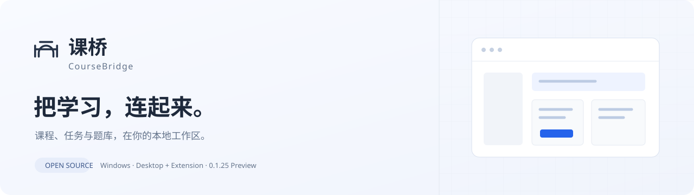
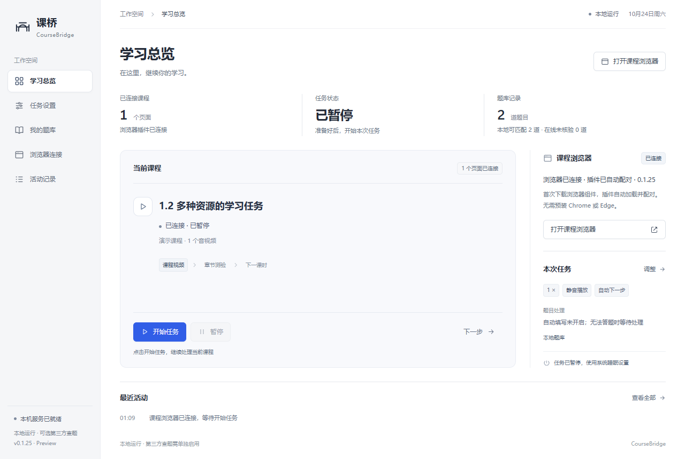
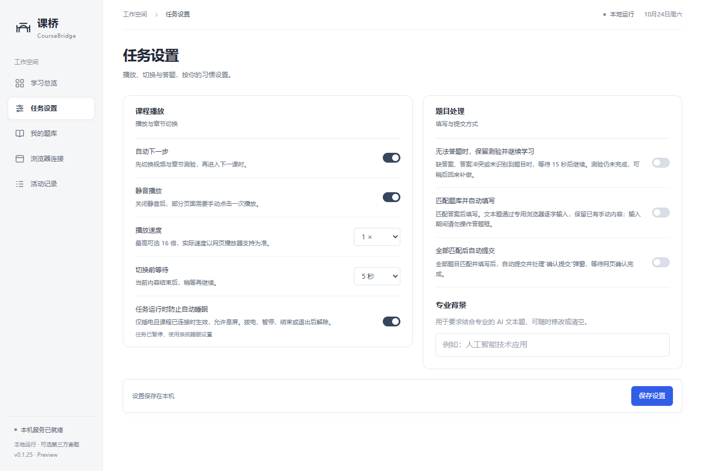
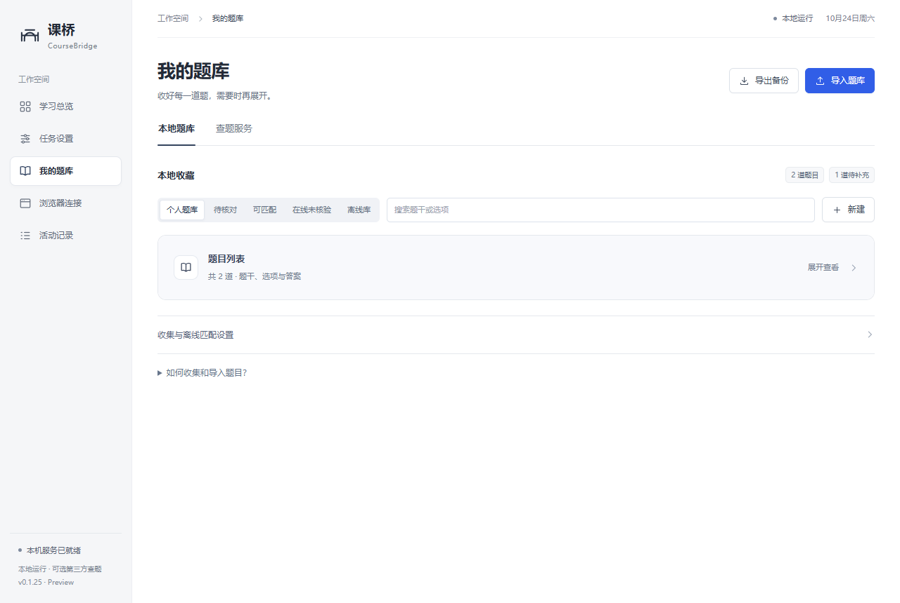

<div align="center">



**一个简洁的本地课程助手。桌面端与浏览器插件，源码全部开放。**

[](https://github.com/xiaopeng77777/CourseBridge/releases/tag/v0.1.25)
[](#开始使用)
[](LICENSE)
[](https://github.com/xiaopeng77777/CourseBridge/actions/workflows/checks.yml)

[下载安装](https://github.com/xiaopeng77777/CourseBridge/releases/tag/v0.1.25) · [使用说明](docs/GETTING_STARTED.md) · [来源与致谢](docs/ATTRIBUTION.md) · [反馈问题](https://github.com/xiaopeng77777/CourseBridge/issues)

</div>

## 课桥是什么

课桥把课程页面、任务状态和个人题库放在一个桌面工作区，主要适配学习通网页版。它通过独立课程浏览器加载本地插件，登录由你在学习通官方页面完成。

这是一个仍在迭代的个人开源项目，**不是学习通、OCS、言溪或 DeepSeek 的官方产品，也没有上述服务的授权背书或合作关系。** 不提供学习通官方题库，不承诺答案正确、课程兼容或考试通过。



<sub>界面示例使用虚构数据，不包含真实账号、试卷或学习记录。</sub>

<details>
<summary>查看任务设置与折叠题库界面</summary>




</details>

## 能做什么

| 能力 | 当前实现 |
| --- | --- |
| 专用课程浏览器 | 独立登录资料，自动加载、配对本地插件；无需预装 Google Chrome |
| 课程任务 | 识别视频、图片、文档及同节多个资源；按页面反馈判断状态和切换环节 |
| 播放设置 | 静音、切换等待、1–16 倍速选项；实际速度和完成条件由网页播放器决定 |
| 本地题库 | JSON / CSV 导入、搜索、编辑、导出；题目默认折叠，保留来源与待核验状态 |
| 可选查题 | 本地 → 言溪 → DeepSeek，或本地加其中一个服务；账号与费用自行承担 |
| 文本题 | 识别填空、简答和论述题；专用浏览器输入并回读核对，失败时保留人工处理 |
| 任务与电源状态 | 本地活动记录、等待原因、插电运行时的防自动睡眠；允许系统息屏 |

自动填写、自动提交默认关闭。网络答案可选择存回本地，并明确标记来源和未核验状态。**没有资料时，本地题库为空是正常的**；安装软件不包含任何第三方查题额度。

## 开始使用

1. 在 [Releases](https://github.com/xiaopeng77777/CourseBridge/releases/tag/v0.1.25) 下载 `CourseBridge-0.1.25-Setup.exe`，安装后启动课桥。
2. 点击“打开课程浏览器”。首次使用会询问是否从上游官方分发地址下载浏览器组件，需联网并预留约 200 MB 下载空间。
3. 在官方页面自行登录，进入具体课程章节；回到课桥确认连接状态。
4. 按需要导入有权使用的题库，或在“我的题库 → 查题服务”自行配置言溪 / DeepSeek，再调整任务设置并开始。

需要 Windows 10 / 11 x64。当前安装包未做数字签名，发布页提供 SHA-256 校验文件。安装器可选择目录，不需要管理员权限。浏览器组件下载失败不会影响本地题库管理，可检查网络后重试。

详细操作、费用、数据目录和故障处理见 [使用说明](docs/GETTING_STARTED.md)。

## 题库和 AI，分别是什么关系

```text
你有权使用的本地题库
        ↓ 未匹配，且你已开启在线来源
言溪题库（独立账号、独立次数）
        ↓ 未匹配，且策略允许
DeepSeek API（独立 API Key、按服务商计费）
        ↓ 按你的设置
保存到本地，保留来源并标记未核验
```

你可以选择仅本地、本地 → 言溪、本地 → DeepSeek、本地 → 言溪 → DeepSeek。调用只使用已配置且启用的来源，不会为了比较费用对每题重复请求两个服务。

言溪的数据、账号和剩余次数由[言溪官网](https://tk.enncy.cn/)管理；DeepSeek 的模型、价格和余额以[官方平台](https://platform.deepseek.com/)为准。课桥不销售、赠送或代理这两项服务，也不把软件开源许可证延伸到它们的题目数据和生成结果。

## 请先了解这些限制

- 页面结构、登录方式、视频完成条件和考试规则可能变化，识别结果应与官方页面核对。
- **整卷预览保持只读保护**；不能保证一次加载全部试题，也不会把“当前页已填完”当成“整份试卷已完成”。
- 文本题在本地模拟编辑器完成了输入校验，但真实考试的全流程兼容仍不充分；缺答案、字数不足或输入未确认时需要人工处理。
- 插电防睡眠不覆盖合盖、电量不足、用户主动睡眠等系统行为；浏览器媒体请求仍可能影响息屏，完整静置实测尚未完成。
- 当前没有软件内联网自动更新；请从 Releases 下载新版本。插件文件更新与网络下载安装更新是两回事。
- 使用前确认所在学校、课程及服务方允许相关辅助功能。项目不提供伪造学习时长、篡改成绩或跳过平台验证的功能。

## 开发与构建

全部应用源码在这个仓库中，无闭源课桥后端。桌面端采用 Electron，插件采用 Manifest V3，界面使用本地 HTML / CSS / JavaScript，不依赖在线字体。

```powershell
git clone https://github.com/xiaopeng77777/CourseBridge.git
cd CourseBridge
npm ci
npm run browser:install
npm start
```

需要 Node.js 24+。测试与安装包构建：

```powershell
npm test
npm run test:desktop
npm run package:win
npm ci --prefix packaging
npm run installer:win
```

可执行的构建步骤、浏览器测试环境及目录结构见 [贡献指南](CONTRIBUTING.md) 和 [架构说明](docs/ARCHITECTURE.md)。构建输出不包含个人配置或题库数据。
本版实际执行过的检查与未覆盖场景见 [发行验证](docs/VALIDATION.md)。

## 来源、借鉴与许可证

课桥最初通过对 **OCS Desktop 2.9.24** 的本地行为分析，以及公开 OCS Desktop / OCSJS 仓库的调研，理解“桌面端 + 浏览器端”的工作方式；随后编写课桥自己的连接协议、界面、状态聚合、适配与题库逻辑。它不是 OCS 的官方版本，也不把别人的工作描述为全部原创。

**实际随代码分发的第三方材料**包括 Photopea 的 Typr.js 字体解析器，以及作者 wyn665817、由 OCS CDN 托管的 MIT 字形映射表；原文件与许可证均保留在 `desktop/vendor/`。Electron、Playwright 和它们的依赖另有各自许可证。

界面设计方法参考 Impeccable、UI UX Pro Max 和 Anthropic frontend-design；本次仓库页面整理参考 crafting-effective-readmes 与 Best-README-Template。它们不是运行时依赖。具体链接、版本、用途和范围请阅读 [完整来源清单](docs/ATTRIBUTION.md) 与 [第三方声明](THIRD_PARTY_NOTICES.md)。

课桥自行编写的代码按 [MIT](LICENSE) 开源。第三方组件保留各自许可，商标、课程内容、题库数据和服务账号不因本项目开源而获得授权。没有明确再分发许可的历史题库已从公开发行内容中排除；发现遗漏可按 [版权反馈流程](docs/ATTRIBUTION.md#版权反馈)提出。

## 隐私与贡献

0.1.25 不包含 0.1.24 特殊测试版的后台用量试验模块、自动统计导出或监控上报。普通活动记录和账户额度显示用于本地操作反馈，详见 [隐私说明](docs/PRIVACY.md)。

欢迎提交兼容性问题、修复和文档改进。请先阅读 [CONTRIBUTING](CONTRIBUTING.md)，不要在 Issue、截图或补丁中提交 API Key、配对码、二维码、学号和真实试卷。安全问题见 [SECURITY](SECURITY.md)。

<div align="center"><sub>课桥 · CourseBridge · 0.1.25 Preview<br/>源码开放，来源透明，数据由你管理。</sub></div>
