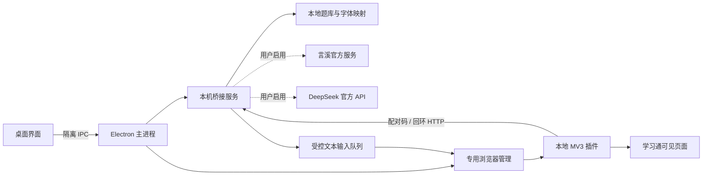

# 架构说明

课桥是本机桌面程序与 MV3 插件的组合，没有必需的课桥云后端。

## 目录与职责

| 路径 | 职责 |
| --- | --- |
| `desktop/main.cjs`、`preload.cjs` | 窗口生命周期、受限 IPC、本地配置与导入导出 |
| `desktop/bridge.cjs` | 回环服务、随机配对、页面状态聚合和查题调度 |
| `desktop/browser.cjs`、`browser-runtime.cjs` | 专用资料目录、插件加载和首次组件下载 |
| `desktop/library.cjs`、`offline-bank.cjs` | 用户题库及可选的授权离线 SQLite 数据读取 |
| `desktop/enncy.cjs`、`deepseek.cjs` | 可选服务配置、系统加密、限速、取消和结果解析 |
| `desktop/typing.cjs` | 以当前页面与任务状态为边界的文本输入队列 |
| `desktop/font.cjs`、`vendor/` | 本地字体解析和有来源声明的第三方映射 |
| `desktop/ui/` | 无框架本地界面，CSP 禁止远端脚本与界面直接联网 |
| `extension/` | 课程页面、试题、编辑器、资源和完成状态识别 |
| `scripts/`、`packaging/` | 检查、图标与安装包构建；不复制正在使用的数据 |
| `tests/`、`examples/` | 合成页面与虚构题目，不需要真实考试或第三方账号 |

插件只在匹配的超星域名页面运行，排除登录和验证码主机，不申请读取普通浏览器历史、剪贴板或密码库权限。桌面窗口启用 contextIsolation、sandbox，关闭 nodeIntegration；IPC 核对调用窗口来源。

查题返回选项索引或当前题文本答案，不把整个本地题库交给课程页面。在线请求有独立队列、速率间隔和取消机制；答案是否存本地由设置决定。整卷预览不会触发受控文本输入。

`browser.checkUpdates` 仅检查本地扩展文件变化并在安全时机重载，不是从互联网下载软件更新。0.1.25 尚未实现软件内自动更新、服务器统计或远程账号管理。
